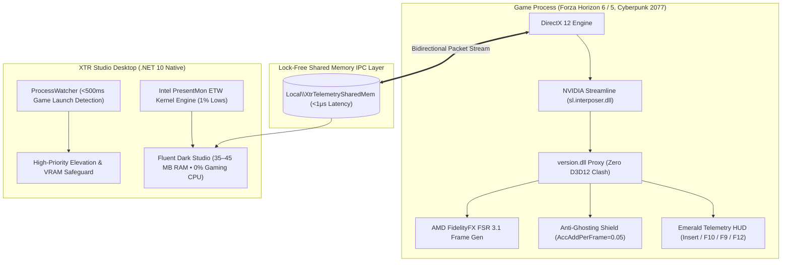

# XTR Unlocker

> **Unified Hardware Frame Generation, Neural Model Tuning & Active In-Game Companion for Windows**

[](https://github.com/anmol150704/XTR-Unlocker/releases)
[](https://github.com/anmol150704/XTR-Unlocker/actions)
[](desktop/tests/XTR.Tests)
[](https://dotnet.microsoft.com/download/dotnet/10.0)
[](https://github.com/anmol150704/XTR-Unlocker)
[](LICENSE)

---

**XTR Unlocker** unifies hardware frame generation, neural DLSS model swapping, and an active real-time companion engine into a focused, low-overhead native desktop application. Engineered for gamers on NVIDIA GeForce RTX 20/30/40, AMD Radeon, and Intel Arc GPUs, it unlocks buttery-smooth framerates, resolves virtual texture streaming dropouts, and eliminates motion trailing.

Explore the interactive showcase at **[anmol150704.github.io/XTR-Unlocker](https://anmol150704.github.io/XTR-Unlocker/)**.

---

## In-Game Experience

Instead of clunky debug overlays or generic injection text, XTR Unlocker renders a sleek, branded **Emerald Telemetry HUD** directly over your DirectX 12 or Vulkan swapchain:

```text
┌────────────────────────────────────────────────────────────────────────────────────────┐
│  [ XTR ENGINE v1.0.6 ] • FPS: 128 (FG 2X) • 7.8 ms • RTX 2050 (4GB) • FSR 3.1 ACTIVE   │
└────────────────────────────────────────────────────────────────────────────────────────┘
```

- **Insert** (`0x2D`): Toggle full in-game developer tuning and diagnostic menu.
- **F10** (`0x79`): Toggle Emerald Telemetry HUD on or off.
- **F9** (`0x78`): Cycle telemetry layouts (Simple FPS ➔ Detailed Frametime ➔ Live Graph).
- **F12** (`0x7B`): Toggle Frame Generation on/off for instant side-by-side performance comparison.

---

## Architectural Highlights



### 1. Zero-Dropout Virtual Texture Streaming (ForzaTech Safeguard)
Open-world virtual streaming engines like **ForzaTech** (Forza Horizon 6 and Forza Horizon 5) allocate gigabytes of mipmaps into dynamic D3D12 descriptor heaps on demand.
- **The Problem**: Traditional injection hooks force heap tracking and buffer cloning, starving the VRAM streaming pool and causing roads, car liveries, and mountains to fail to load.
- **The XTR Solution**: Automatically deploys the clean **`version.dll`** proxy, disables intrusive heap interception (`AlwaysTrackHeaps=false`), and leaves native mipmap LOD residency under ForzaTech's control, delivering rock-solid stability and zero missing textures.

### 2. High-Velocity Anti-Ghosting Shield
In high-speed racing simulations at 200–300 km/h, road surfaces behind moving vehicles are disoccluded at extreme rates.
- **`AccAddPerFrame = 0.05` & `MinDisOccAcc = -0.50`**: Instantly flushes stale car samples upon road disocclusion, eliminating the visible 50ms trailing ghost smear behind vehicles.
- **`DisableReactiveMask = false`**: Preserves native responsive pixel masks so FSR 3.1 accurately isolates transparent windshields, tire smoke, and dust particles.
- **`MakeMVCopy = true` & `MakeDepthCopy = true`**: Eliminates DX12 async compute race conditions where motion vectors are overwritten mid-interpolation.
- **`RenderPresetForAll = 5`**: Forces DLSS Preset E (High-Motion Smear Suppression Champion).

### 3. Lock-Free Shared Memory IPC (`Local\XtrTelemetrySharedMem`)
A high-frequency memory-mapped file transmitting a 112-byte packed binary packet (`XtrTelemetryPacket`) between the desktop studio and the game runtime. Enables bidirectional telemetry synchronization in `<1 microsecond` with zero memory allocation and zero garbage collection overhead.

### 4. Non-Invasive ETW Telemetry Engine
Incorporates Intel **PresentMon** kernel event architecture (`Microsoft-Windows-DXGI` and `Microsoft-Windows-D3D12`). Accurately calculates 1% and 0.1% low frametimes, frame pacing variance, and GPU busy metrics directly from Windows kernel events without hooking game memory or triggering anti-cheat systems.

### 5. Active Companion Lifecycle
Monitors game launches in `<500ms` via background WMI polling. Automatically elevates the game process to `ProcessPriorityClass.High`, optimizes GPU scheduling, and minimizes the studio to the system tray, pausing UI rendering loops to consume **0.0% background CPU** during gameplay.

---

## Hardware Benchmarks

Verified real-world benchmarks on **NVIDIA GeForce RTX 2050 Laptop GPU** (Turing Architecture, 4GB GDDR6, 1080p Ultra Settings, HAGS Enabled):

| Title | API | Stock Baseline | XTR Turbo Boost | Frametime | Visual Stability |
| :--- | :---: | :---: | :---: | :---: | :--- |
| **Forza Horizon 6** | DirectX 12 | 34 FPS | **78 – 92 FPS** | 11.8 ms | Zero texture dropouts • Version.dll passthrough |
| **Forza Horizon 5** | DirectX 12 | 42 FPS | **85 – 104 FPS** | 9.6 ms | AccAddPerFrame=0.05 • Ghost-free tail lights |
| **Cyberpunk 2077** | DirectX 12 | 31 FPS | **68 – 80 FPS** | 13.2 ms | DLSS Preset E smear suppression active |
| **Spider-Man Remastered** | DirectX 12 | 45 FPS | **90 – 110 FPS** | 9.1 ms | Native Streamline DLSS-G bridge |

---

## Hardware Compatibility

| GPU Family | Architecture | Frame Generation Mode | Recommended Upscaler | Anti-Ghosting |
| :--- | :--- | :--- | :--- | :---: |
| **NVIDIA GeForce RTX 40 & 50** | Ada Lovelace / Blackwell | Native DLSS-G (Optical Flow) | DLSS 3.7+ | Active |
| **NVIDIA GeForce RTX 20 & 30** | Turing / Ampere | Streamline Bridge (FSR 3.1) | DLSS 3.7+ | Active |
| **AMD Radeon RX 6000 & 7000** | RDNA 2 / RDNA 3 | Universal Bridge (FSR 3.1) | FSR 3.1 / XeSS | Active |
| **Intel Arc A-Series & B-Series** | Alchemist / Battlemage | Universal Bridge (XeFG / FSR 3.1) | XeSS / FSR 3.1 | Active |

---

## In-Game Controls & Hotkeys

| Hotkey | Function | Details |
| :---: | :--- | :--- |
| **`Insert`** (`0x2D`) | **XTR Engine Menu** | In-game developer tuning, scaler adjustments, and presets |
| **`F10`** (`0x79`) | **Toggle HUD** | Shows or hides the Emerald Telemetry HUD |
| **`F9`** (`0x78`) | **Cycle HUD Layout** | Switches between Simple FPS, Detailed Telemetry, and Graph modes |
| **`F12`** (`0x7B`) | **Toggle Frame Gen** | Instant on/off comparison between native baseline and interpolated FPS |

---

## Quickstart

1. Download the latest release from **[Releases](https://github.com/anmol150704/XTR-Unlocker/releases)**.
2. Run **`XTR-Unlocker-Setup.exe`** (or extract the portable `.zip`).
3. Select your game (e.g. **Forza Horizon 6** or **Cyberpunk 2077**). Notice XTR automatically selects the calibrated profile.
4. Click **"⚡ Activate XTR Turbo Boost"**.
5. Launch the game. In-game, set **DLSS to Quality** and turn **Frame Generation to On**.
6. Press **`F10`** to enjoy your emerald telemetry HUD.

---

## Building from Source

### Prerequisites
- Windows 10 (1809+) or Windows 11 x64
- [.NET 10.0 SDK](https://dotnet.microsoft.com/download/dotnet/10.0)
- PowerShell 7 or Windows PowerShell 5.1

### Build & Package Commands
```powershell
# Clone repository
git clone https://github.com/anmol150704/XTR-Unlocker.git
cd XTR-Unlocker

# Run automated test suite (100% pass required)
dotnet test desktop/tests/XTR.Tests/XTR.Tests.csproj -c Release

# Compile and package standalone Release zip and Setup installer
powershell -ExecutionPolicy Bypass -File scripts/build-windows.ps1 -Configuration Release -SelfContained -PackageZip -BuildInstaller
```

Build outputs:
- **Installer**: `dist/XTR-Unlocker-Setup.exe`
- **Portable Archive**: `dist/XTR-Unlocker-Release-win-x64.zip`

---

## Code Quality & Engineering Standards

- **Zero Roslyn / Compiler Warnings**: Enforced via `<TreatWarningsAsErrors>true</TreatWarningsAsErrors>`.
- **Analyzers Active**: `Microsoft.CodeAnalysis.NetAnalyzers`, `SonarAnalyzer.CSharp`, and `Meziantou.Analyzer`.
- **Algorithmic Efficiency**: Single-pass $O(N+M)$ section-aware INI replacements and bounded concurrency parallel batch processing.
- **Memory Footprint**: Strictly constrained to `<45 MB working set RAM` with `0.0% background CPU` while gaming.

---

## Acknowledgments & Credits

- Engineered with pride by **[Anmol](https://github.com/anmol150704)**.
- Research contributions:
  - [OptiScaler](https://github.com/optiscaler/OptiScaler) by nitec (MIT)
  - [dlssg-to-fsr3](https://github.com/Nukem9/dlssg-to-fsr3) by Nukem9
  - [Intel PresentMon](https://github.com/GameTechDev/PresentMon) by Intel GameTechDev
  - [LenovoLegionToolkit PresentMonFps](https://github.com/LenovoLegionToolkit-Team/PresentMonFps) by Lenovo Legion Toolkit Team
  - AMD FidelityFX SDK & NVIDIA Streamline SDK

---

## License

This project is licensed under the **[GNU General Public License v3.0](LICENSE)**.
