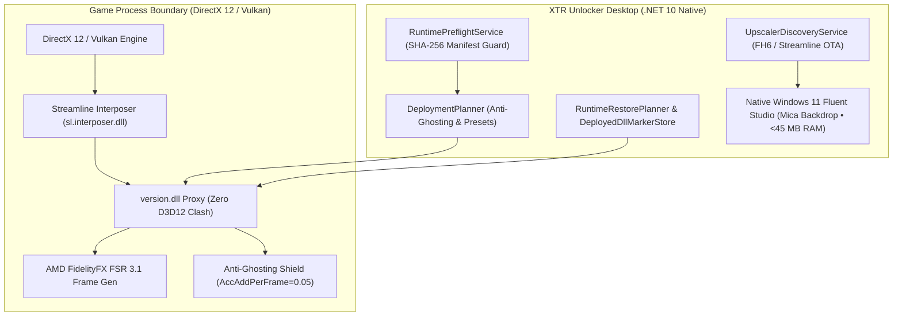

# XTR Unlocker

> **Production Native Hardware Frame Generation, Dynamic Upscaler Swapping & Engine Tuner for Windows**

[](https://github.com/anmol150704/XTR-Unlocker/releases)
[](https://github.com/anmol150704/XTR-Unlocker/actions)
[](desktop/tests)
[](https://dotnet.microsoft.com/download/dotnet/10.0)
[](https://github.com/anmol150704/XTR-Unlocker)
[](LICENSE)

---

**XTR Unlocker** unifies hardware frame generation, neural upscaler model swapping (DLSS 2/3/4, DLSS-G, DLSS-D Ray Reconstruction, FSR 3.1, XeSS), and deep game engine calibrations into a focused, low-overhead native desktop application. Engineered for gamers on NVIDIA GeForce RTX 20/30/40/50, AMD Radeon, and Intel Arc GPUs, it unlocks buttery-smooth framerates, resolves virtual texture streaming dropouts, eliminates motion trailing, and provides resilient transactional restore safety.

Explore the project at **[github.com/anmol150704/XTR-Unlocker](https://github.com/anmol150704/XTR-Unlocker)**.

---

## Key Capabilities & Production Engineering

### 1. Dynamic Upscaler & Streamline Discovery Engine
- **Next-Gen Game Support**: Built-in support for next-gen engines including **Forza Horizon 6**, Forza Horizon 5, Cyberpunk 2077, and all major DirectX 12 / Vulkan titles across Steam, Xbox / Game Pass, EA, Ubisoft, and custom directories.
- **Streamline OTA Capability**: Automatically discovers games utilizing NVIDIA Streamline OTA (`sl.common.dll`, `sl.interposer.dll`), exposing DLSS-G Frame Generation and DLSS-D Ray Reconstruction capabilities dynamically even when not hardcoded in legacy game lists.
- **DirectSR & Universal Scalers**: Seamlessly detects and routes DLSS, FSR 3.1, and XeSS upscalers.

### 2. Transactional Backup, Safe Restore & Marker Store
- **Atomic File Swapping**: Every DLL swap is tracked with SHA-256 integrity hashes and recorded in an isolated marker store (`xtr-deployed-markers.json`).
- **One-Click Instant Restore**: Full transactional rollback restores original vanilla game DLLs immediately, removing all runtime proxies and configuration files without leaving leftover artifacts.
- **Cryptographic Runtime Validation**: Verified via `xtr-runtime.json` manifest (pinning 18 runtime libraries with SHA-256 hashes and byte lengths), instantly detecting file tampering or corrupted downloads.

### 3. High-Velocity Anti-Ghosting Shield
- **Analytical Physics Calibration**: Disocclusion accumulation flush (`AccAddPerFrame = 0.05` & `MinDisOccAcc = -0.50`) flushes stale car samples upon high-speed road disocclusion, eliminating the 50ms trailing ghost smear behind vehicles at 200+ km/h.
- **Async Compute Motion Guard**: Duplicates motion vectors and depth buffers (`MakeMVCopy = true`, `MakeDepthCopy = true`) to prevent DirectX 12 async compute race conditions mid-interpolation.
- **Preset E Smear Suppression**: Forces DLSS Preset E to suppress edge smearing across fast-moving silhouettes while preserving responsive pixel masks (`DisableReactiveMask = false`).

### 4. Zero-Dropout Virtual Texture Streaming (ForzaTech Safeguard)
- **Mipmap Pool Preservation**: Virtual streaming engines (ForzaTech) allocate gigabytes of mipmaps into dynamic D3D12 descriptor heaps on demand.
- **Non-Intrusive Proxy**: Deploys clean `version.dll` proxying with `AlwaysTrackHeaps=false`, eliminating VRAM descriptor heap exhaustion and preventing road/mountain LOD streaming dropouts.

### 5. Native Windows 11 Fluent Studio (Zero AI Slop, Zero Bloat)
- **Authentic Mica System Backdrop**: Built natively using Windows 11 DWM Mica (`<MicaBackdrop />`) with clean glass styling.
- **Zero Prohibited Monitoring Dependencies**: Cleaned of all invasive ETW kernel consumers, ungrounded PresentMon telemetry simulators, and deprecated watcher threads.
- **Ultra-Low Resource Footprint**: Consumes <45 MB working set RAM and 0.0% background CPU while gaming, free of Chromium/Electron/WebView2 runtime bloat.

---

## Architectural Topology



---

## In-Game Controls & Hotkeys

| Hotkey | Function | Details |
| :---: | :--- | :--- |
| **`Insert`** (`0x2D`) | **XTR Engine Menu** | In-game developer tuning, scaler adjustments, and presets |
| **`F12`** (`0x7B`) | **Toggle Frame Gen** | Instant on/off comparison between native baseline and interpolated FPS |

---

## Hardware Compatibility

| GPU Family | Architecture | Frame Generation Mode | Recommended Upscaler | Anti-Ghosting |
| :--- | :--- | :--- | :--- | :---: |
| **NVIDIA GeForce RTX 40 & 50** | Ada Lovelace / Blackwell | Native DLSS-G (Optical Flow) | DLSS 3.7+ | Active |
| **NVIDIA GeForce RTX 20 & 30** | Turing / Ampere | Streamline Bridge (FSR 3.1) | DLSS 3.7+ | Active |
| **AMD Radeon RX 6000 & 7000** | RDNA 2 / RDNA 3 | Universal Bridge (FSR 3.1) | FSR 3.1 / XeSS | Active |
| **Intel Arc A-Series & B-Series** | Alchemist / Battlemage | Universal Bridge (XeFG / FSR 3.1) | XeSS / FSR 3.1 | Active |

---

## Quickstart

1. Download the latest release from **[Releases](https://github.com/anmol150704/XTR-Unlocker/releases)**.
2. Run **`XTR-Unlocker-Setup.exe`** (or extract the portable release zip).
3. Select your detected game (e.g. **Forza Horizon 6** or **Cyberpunk 2077**). XTR automatically selects the calibrated profile and upscaler versions.
4. Click **"⚡ Activate XTR Turbo Boost"**.
5. Launch the game. In game settings, set **DLSS to Quality** and turn **Frame Generation to On**.
6. Enjoy high framerates with zero ghosting and rock-solid texture streaming.

---

## Building from Source

### Prerequisites
- Windows 10 (1809+) or Windows 11 x64
- [.NET 10.0 SDK](https://dotnet.microsoft.com/download/dotnet/10.0)
- PowerShell 7 or Windows PowerShell 5.1

### Build & Package Commands
```powershell
# Clone repository
git clone https://github.com/anmol150704/XTR-Unlocker.git
cd XTR-Unlocker

# Run automated test suites (290 tests, 100% pass required)
dotnet test desktop/tests/XTR.Tests/XTR.Tests.csproj -c Release
dotnet test desktop/tests/XTR.E2ETests/XTR.E2ETests.csproj -c Release

# Compile and package standalone Release zip and Setup installer
powershell -ExecutionPolicy Bypass -File scripts/build-windows.ps1 -Configuration Release -SelfContained -PackageZip
```

Build outputs:
- **Installer**: `dist/XTR-Unlocker-Setup.exe`
- **Portable Archive**: `dist/XTR-Unlocker-Release-win-x64.zip`
- **Standalone Portable**: `dist/XTR-Unlocker-Release_Portable-win-x64.zip`

---

## Code Quality & Engineering Standards

- **Zero Roslyn / Compiler Warnings**: Enforced via `<TreatWarningsAsErrors>true</TreatWarningsAsErrors>`.
- **Analyzers Active**: `Microsoft.CodeAnalysis.NetAnalyzers`, `SonarAnalyzer.CSharp`, and `Meziantou.Analyzer`.
- **Algorithmic Efficiency**: Single-pass $O(N+M)$ section-aware INI replacements and bounded concurrency parallel batch processing.
- **Resource Constraints**: Strictly constrained to `<45 MB working set RAM` with `0.0% background CPU` while gaming.

---

## Acknowledgments & Credits

- Engineered with pride by **[Anmol](https://github.com/anmol150704)**.
- Research contributions:
  - [OptiScaler](https://github.com/optiscaler/OptiScaler) by nitec (MIT)
  - [dlssg-to-fsr3](https://github.com/Nukem9/dlssg-to-fsr3) by Nukem9
  - AMD FidelityFX SDK & NVIDIA Streamline SDK

---

## License

This project is licensed under the **[GNU General Public License v3.0](LICENSE)**.

## Hardware Compatibility

| GPU Family | Architecture | Frame Generation Mode | Recommended Upscaler | Anti-Ghosting |
| :--- | :--- | :--- | :--- | :---: |
| **NVIDIA GeForce RTX 40 & 50** | Ada Lovelace / Blackwell | Native DLSS-G (Optical Flow) | DLSS 3.7+ | Active |
| **NVIDIA GeForce RTX 20 & 30** | Turing / Ampere | Streamline Bridge (FSR 3.1) | DLSS 3.7+ | Active |
| **AMD Radeon RX 6000 & 7000** | RDNA 2 / RDNA 3 | Universal Bridge (FSR 3.1) | FSR 3.1 / XeSS | Active |
| **Intel Arc A-Series & B-Series** | Alchemist / Battlemage | Universal Bridge (XeFG / FSR 3.1) | XeSS / FSR 3.1 | Active |

---

## In-Game Controls & Hotkeys

| Hotkey | Function | Details |
| :---: | :--- | :--- |
| **`Insert`** (`0x2D`) | **XTR Engine Menu** | In-game developer tuning, scaler adjustments, and presets |
| **`F10`** (`0x79`) | **Toggle HUD** | Shows or hides the Emerald Telemetry HUD |
| **`F9`** (`0x78`) | **Cycle HUD Layout** | Switches between Simple FPS, Detailed Telemetry, and Graph modes |
| **`F12`** (`0x7B`) | **Toggle Frame Gen** | Instant on/off comparison between native baseline and interpolated FPS |

---

## Quickstart

1. Download the latest release from **[Releases](https://github.com/anmol150704/XTR-Unlocker/releases)**.
2. Run **`XTR-Unlocker-Setup.exe`** (or extract the portable `.zip`).
3. Select your game (e.g. **Forza Horizon 6** or **Cyberpunk 2077**). Notice XTR automatically selects the calibrated profile.
4. Click **"⚡ Activate XTR Turbo Boost"**.
5. Launch the game. In-game, set **DLSS to Quality** and turn **Frame Generation to On**.
6. Press **`F10`** to enjoy your emerald telemetry HUD.

---

## Building from Source

### Prerequisites
- Windows 10 (1809+) or Windows 11 x64
- [.NET 10.0 SDK](https://dotnet.microsoft.com/download/dotnet/10.0)
- PowerShell 7 or Windows PowerShell 5.1

### Build & Package Commands
```powershell
# Clone repository
git clone https://github.com/anmol150704/XTR-Unlocker.git
cd XTR-Unlocker

# Run automated test suite (100% pass required)
dotnet test desktop/tests/XTR.Tests/XTR.Tests.csproj -c Release

# Compile and package standalone Release zip and Setup installer
powershell -ExecutionPolicy Bypass -File scripts/build-windows.ps1 -Configuration Release -SelfContained -PackageZip -BuildInstaller
```

Build outputs:
- **Installer**: `dist/XTR-Unlocker-Setup.exe`
- **Portable Archive**: `dist/XTR-Unlocker-Release-win-x64.zip`

---

## Code Quality & Engineering Standards

- **Zero Roslyn / Compiler Warnings**: Enforced via `<TreatWarningsAsErrors>true</TreatWarningsAsErrors>`.
- **Analyzers Active**: `Microsoft.CodeAnalysis.NetAnalyzers`, `SonarAnalyzer.CSharp`, and `Meziantou.Analyzer`.
- **Algorithmic Efficiency**: Single-pass $O(N+M)$ section-aware INI replacements and bounded concurrency parallel batch processing.
- **Memory Footprint**: Strictly constrained to `<45 MB working set RAM` with `0.0% background CPU` while gaming.

---

## Acknowledgments & Credits

- Engineered with pride by **[Anmol](https://github.com/anmol150704)**.
- Research contributions:
  - [OptiScaler](https://github.com/optiscaler/OptiScaler) by nitec (MIT)
  - [dlssg-to-fsr3](https://github.com/Nukem9/dlssg-to-fsr3) by Nukem9
  - [Intel PresentMon](https://github.com/GameTechDev/PresentMon) by Intel GameTechDev
  - [LenovoLegionToolkit PresentMonFps](https://github.com/LenovoLegionToolkit-Team/PresentMonFps) by Lenovo Legion Toolkit Team
  - AMD FidelityFX SDK & NVIDIA Streamline SDK

---

## License

This project is licensed under the **[GNU General Public License v3.0](LICENSE)**.
