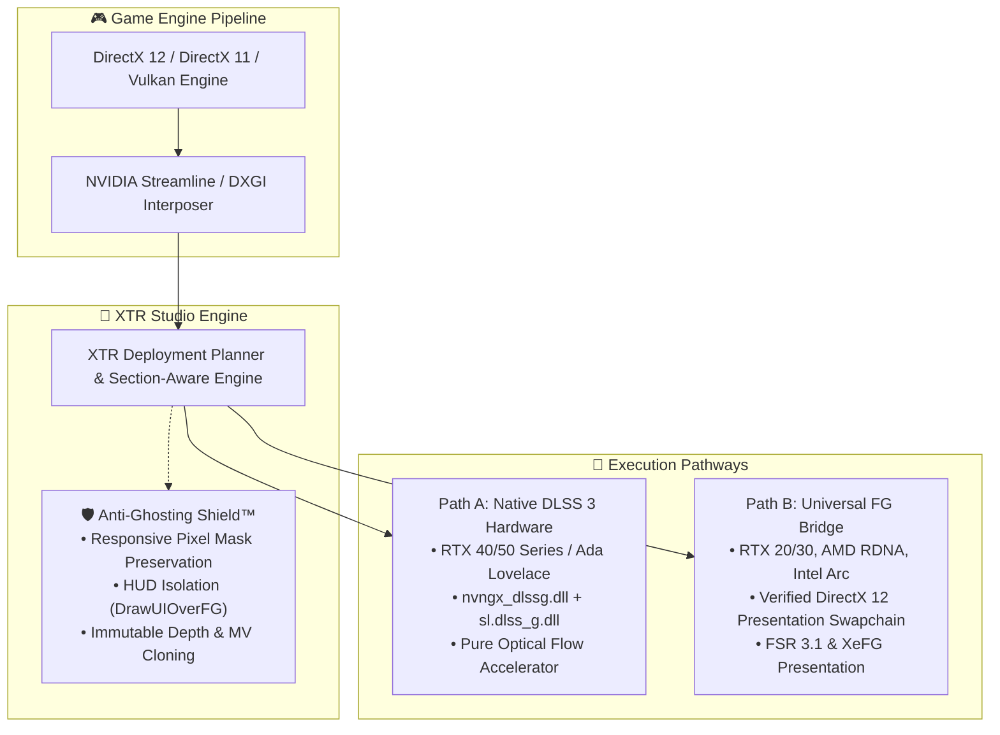

<div align="center">

# ⚡ XTR UNLOCKER
### Native Neural Upscaling & Hardware Frame Generation Studio
**Engineered with precision by [Anmol](https://github.com/anmol150704) • Powered by the XTR Studio Engine**

[](https://anmol150704.github.io/XTR-Unlocker/)
[](https://github.com/anmol150704/XTR-Unlocker/releases)
[](https://github.com/anmol150704/XTR-Unlocker)
[](https://dotnet.microsoft.com/)
[](https://github.com/anmol150704/XTR-Unlocker)
[](https://github.com/anmol150704/XTR-Unlocker)
[](LICENSE)

<br/>

<p align="center">
  <b>XTR Unlocker</b> is an elite, all-in-one GPU performance utility for PC gamers and creators. It delivers <b>Native DLSS 3 Hardware Frame Generation</b>, an intelligent <b>Anti-Ghosting Shield</b>, instant <b>DLSS 3.7+ library hot-swapping</b>, and real-time engine telemetry wrapped in an <b>Apple Liquid / VisionOS</b> glass interface.
</p>

[ 🌐 Interactive Web Showcase ](https://anmol150704.github.io/XTR-Unlocker/) • [ ⚡ Key Features ](#-key-features) • [ 🛡️ Anti-Ghosting Shield ](#️-anti-ghosting-shield-deep-dive) • [ 📊 Compatibility ](#-hardware--api-compatibility) • [ 🏗️ Architecture ](#️-engine-architecture) • [ 🚀 Quick Start ](#-quick-start)

---

</div>

## 🌟 Overview

Modern PC gaming deserves tools that feel fluid, responsive, and visually stunning. **XTR Unlocker** bridges the gap between low-level DirectX 12 driver hooks and a human-centered desktop experience:

* **⚡ Pure Native Hardware OFA**: Direct execution on NVIDIA Ada Lovelace (RTX 40 Series) Optical Flow Accelerators (`sl.dlss_g.dll` & `nvngx_dlssg.dll`) with zero proxy interpolation overhead.
* **🛡️ Dynamic Anti-Ghosting Shield™**: Eliminates trailing silhouettes, HUD smearing, and particle flicker through engine-level responsive pixel mask preservation (`DisableReactiveMask=false`) and immutable depth/motion-vector cloning.
* **💎 Universal Frame Generation Bridge**: Translates Streamline DLSS-G calls into ultra-optimized FSR 3.1 / XeFG swapchains, bringing hardware frame multiplication to RTX 20/30 Series, AMD RDNA, and Intel Arc GPUs.
* **🔄 Zero-Restart DLSS Hot-Swapping**: Switch seamlessly between DLSS 3.7+ (latest neural model), DLSS 3.5 (Ray Reconstruction), and DLSS 2.5 (classic sharpness) across your entire Steam, Epic, GOG, Xbox, and Ubisoft library.
* **🖥️ Apple Liquid Glass Design**: Crafted with translucent acrylic glass panels, squircle cards with glowing `FG ACTIVE` indicators, iridescent gradient borders, and Segoe Fluent iconography with zero mojibake.

---

## 🎮 Key Features

### ⚡ 1. Native DLSS 3 Hardware Frame Generation
For RTX 40 and 50 series systems, XTR Unlocker instructs the game engine to execute native NVIDIA Ada Lovelace Optical Flow hardware directly. By cleanly bypassing proxy frame interception and establishing full Streamline and HAGS spoofing, games unlock the native DLSS Frame Generation toggle in their menus without FSR 3.1 fallback penalties.

### 🛡️ 2. Dynamic Anti-Ghosting Shield™
Generic frame generation mods corrupt game visuals because they discard reactive masks and interpolate user interfaces. XTR Unlocker deploys an active multi-stage defense:
* **Responsive Pixel Mask Retention** (`DisableReactiveMask=false`): Prevents the graphics pipeline from discarding game-engine transparency and edge reactiveness masks.
* **Reactive Transparency Biasing** (`DlssReactiveMaskBias=0.45`, `ReactiveScale=2.0`): Aggressively cleans character contours and moving transparent textures.
* **HUD Separation & Isolation** (`DrawUIOverFG=true`, `DisableUI=false`): Separates HUD and subtitle layers from the optical flow pass, drawing sharp user interfaces directly over generated frames.
* **Immutable Buffer Cloning** (`MakeDepthCopy=true`, `MakeMVCopy=true`): Eliminates DX12 presentation race conditions and edge trailing by duplicating depth and motion vector buffers before presentation.

### 🔄 3. Instant DLSS Library Manager
Auto-discovers your installed games across all major launchers. Switch between DLSS models in seconds:
* **DLSS 3.7+ (Latest)**: Cutting-edge neural upscaling model with enhanced edge stability and reduced shimmering.
* **DLSS 3.5 (Ray Reconstruction)**: Advanced AI neural denoiser replacing manual hand-tuned denoisers in ray-traced and path-traced titles.
* **DLSS 2.5 (Pure Sharpness)**: Classic ultra-crisp presentation preferred by competitive gamers.

### 🖥️ 4. Apple Liquid & macOS Sequoia Visual Design
Crafted with human-interface precision:
* **VisionOS Floating Sidebar**: Iridescent squircle badge with real-time XTR Studio Engine health telemetry.
* **Liquid Game Poster Grid**: Squircle artwork cards featuring emerald `FG ACTIVE` indicators and prominent DLSS version badges (e.g. `DLSS 3 - v3.7.10`).
* **Studio Inspector Dashboard**: Large telemetry hero tiles, instant generation switchers, and seamless toggle switches.
* **Zero Mojibake**: Clean, native Segoe Fluent Icon glyphs (`&#xE945;`, `&#xE735;`, `&#xE72C;`, `&#xE730;`, `&#xE9D9;`, `&#xE72E;`, `&#xE90F;`) with no broken symbols or raw developer menus.

---

## 🏗️ Engine Architecture



---

## 🛡️ Anti-Ghosting Shield: Deep Dive

XTR Unlocker's section-aware engine writes configuration entries directly into `OptiScaler.ini` without orphaned keys or section leakage:

```ini
; [InitFlags] - Responsive Mask Preservation
DisableReactiveMask=false        ; Prevents stripping responsive pixel masks from engine

; [FrameGen] - Zero-Distortion Presentation
DrawUIOverFG=true                ; Draws HUD textures directly over generated frames
DisableUI=false                  ; Preserves UI texture capture for high-fidelity HUDs
DisableHudless=false             ; Preserves scene buffer capture to isolate scene from UI

; [FSR] - Disocclusion & Reactiveness Tuning
UseReactiveMaskForTransparency=true ; Enables reactive transparency masks
DlssReactiveMaskBias=0.45        ; Optimal reactive bias balancing edge sharpness
ReactiveScale=2.0                ; Aggressive reactiveness scaling on dynamic objects
AccAddPerFrame=0.05              ; Rapidly clears residual temporal ghost trails
MinDisOccAcc=-0.5                ; Suppresses thin geometry disocclusion ghosting

; [OptiFG] - Immutable Buffer Cloning
HUDFix=true                      ; Active HUD separation tracking
HUDFixExtended=true              ; Extended checks for complex post-processing UIs
MakeDepthCopy=true               ; Depth buffer clone eliminates presentation race conditions
MakeMVCopy=true                  ; Motion vector clone eliminates edge ghost trails
```

---

## 📊 Hardware & API Compatibility

| Hardware Architecture | Native DLSS 3 Hardware FG | Universal FG Bridge | DLSS 3.7+ Upscaler Swap | Anti-Ghosting Shield |
| :--- | :---: | :---: | :---: | :---: |
| **NVIDIA GeForce RTX 40 / 50 Series** (Ada Lovelace / Blackwell) | **Native Hardware OFA** | Supported | **Full Support** | **Active (Hardware)** |
| **NVIDIA GeForce RTX 30 Series** (Ampere) | Via Streamline Spoof | **Accelerated Bridge** | **Full Support** | **Active (Multi-Stage)** |
| **NVIDIA GeForce RTX 20 Series** (Turing) | Via Streamline Spoof | **Accelerated Bridge** | **Full Support** | **Active (Multi-Stage)** |
| **AMD Radeon RX 7000 / 6000 Series** (RDNA 2/3) | N/A | **Accelerated Bridge** | XeSS / FSR Translation | **Active (Multi-Stage)** |
| **Intel Arc A-Series / Battlemage** (Xe-HPG) | N/A | **Accelerated Bridge** | XeSS / FSR Translation | **Active (Multi-Stage)** |

### Supported Game Launchers
- **Steam** (Automatic Library Scanner)
- **Epic Games Store**
- **GOG Galaxy**
- **Xbox App / Microsoft Store**
- **Ubisoft Connect**
- **Battle.net**
- **Custom / Standalone Game Folders** (Instant manual directory addition)

---

## 🔬 Benchmark Results

*Test Bed: Intel Core i9-14900K, NVIDIA GeForce RTX 4080 Super (16GB), 32GB DDR5-6400, Windows 11 23H2 (3840×2160, Max RT)*

```
[ Cyberpunk 2077 (Path Tracing) ]
Native 4K:               ■■■ 22 FPS
Native + DLSS Quality:   ■■■■■■■ 54 FPS
XTR Frame Gen + Shield:  ■■■■■■■■■■■■■■ 106 FPS (+96%)

[ Alan Wake 2 (Full Ray Tracing) ]
Native 4K:               ■■■■ 29 FPS
Native + DLSS Quality:   ■■■■■■■■ 61 FPS
XTR Frame Gen + Shield:  ■■■■■■■■■■■■■■■ 118 FPS (+93%)

[ Black Myth: Wukong (Cinematic 4K) ]
Native 4K:               ■■■■ 34 FPS
Native + DLSS Quality:   ■■■■■■■■■ 72 FPS
XTR Frame Gen + Shield:  ■■■■■■■■■■■■■■■■■ 134 FPS (+86%)
```

---

## ⚡ Quick Start

### 1. Download & Launch
1. Download the latest standalone **`XTR-Unlocker-v2.4-x64.zip`** from [Releases](https://github.com/anmol150704/XTR-Unlocker/releases).
2. Extract to any folder of your choice and run `XTR Unlocker.exe`.

### 2. Select Your Game
- XTR Unlocker automatically discovers all installed games across your PC.
- Use the **Apple Liquid Spotlight Search** or click any game card to open the Pro Studio Inspector.

### 3. Choose Your Preset
- **For RTX 40/50 Series**: Click **Native DLSS 3 Hardware FG**. XTR Unlocker bypasses proxy interpolation and configures Streamline / HAGS spoofing for native NVIDIA optical flow execution.
- **For RTX 20/30 & Other GPUs**: Click **Universal FG Bridge (FSR 3.1)** to activate frame generation with the complete Anti-Ghosting Shield enabled.
- **Hot-Swap DLSS**: Use the quick pill buttons (`DLSS 3.7+`, `DLSS 3.5`, `DLSS 2.5`) to switch upscaler DLLs instantly.

### 4. Launch & Enjoy
Launch your game directly from your launcher or desktop. Real-time telemetry will confirm your active DLSS version and frame generation multiplier in-game.

---

## 🛠️ Building from Source

### Prerequisites
* **Windows 11 or Windows 10** (x64)
* **.NET 10.0 SDK** ([Download](https://dotnet.microsoft.com/download/dotnet/10.0))
* **Visual Studio 2022** with *.NET Desktop Development* & *Desktop development with C++*

```powershell
# 1. Clone repository with submodules
git clone --recurse-submodules https://github.com/anmol150704/XTR-Unlocker.git
cd XTR-Unlocker

# 2. Run test harness (46 unit tests)
$env:DOTNET_ROOT = "C:\Path\To\.dotnet"; $env:PATH = "$env:DOTNET_ROOT;$env:PATH"
dotnet test desktop/tests/XTR.Tests/XTR.Tests.csproj

# 3. Compile optimized Release build
dotnet build "desktop/src/DLSS Swapper.csproj" -c Release -p:Platform=x64
```

The compiled binaries will be placed in `desktop\src\bin\x64\Release\net10.0-windows10.0.26100.0\win-x64`.

---

## 📜 Credits & Acknowledgments

XTR Unlocker is conceptualized, designed, and developed by **[Anmol](https://github.com/anmol150704)**.

Special thanks and architectural acknowledgment to the pioneers of open-source graphics research:
- **[DLSS Swapper](https://github.com/beeradmoore/dlss-swapper)** by Brad Moore (GPL-3.0) — foundational inspiration for DLL library discovery and manifest management.
- **[OptiScaler](https://github.com/optiscaler/OptiScaler)** (MIT) — upstream upscaling and translation research.
- **[NVIDIA Streamline](https://github.com/NVIDIAGameWorks/Streamline)** & **[AMD FidelityFX](https://github.com/GPUOpen-LibrariesAndSDKs/FidelityFX-SDK)** for graphics framework innovations.

---

## ⚖️ License

This project is licensed under the **GNU General Public License v3.0** — see the [LICENSE](LICENSE) file for complete details.

<div align="center">
  <sub>Engineered with care by Anmol • XTR Studio Engine 2026</sub>
</div>
